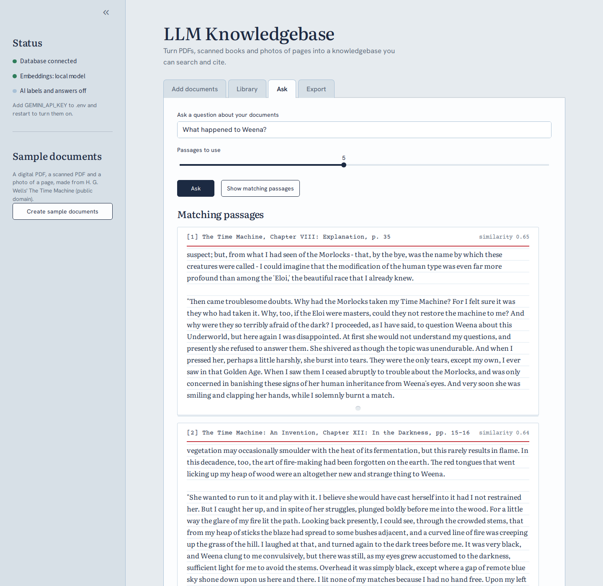
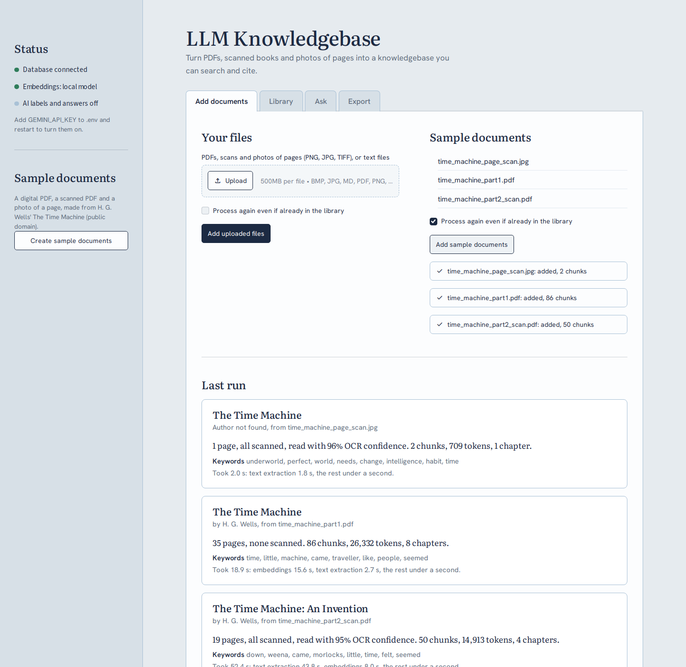
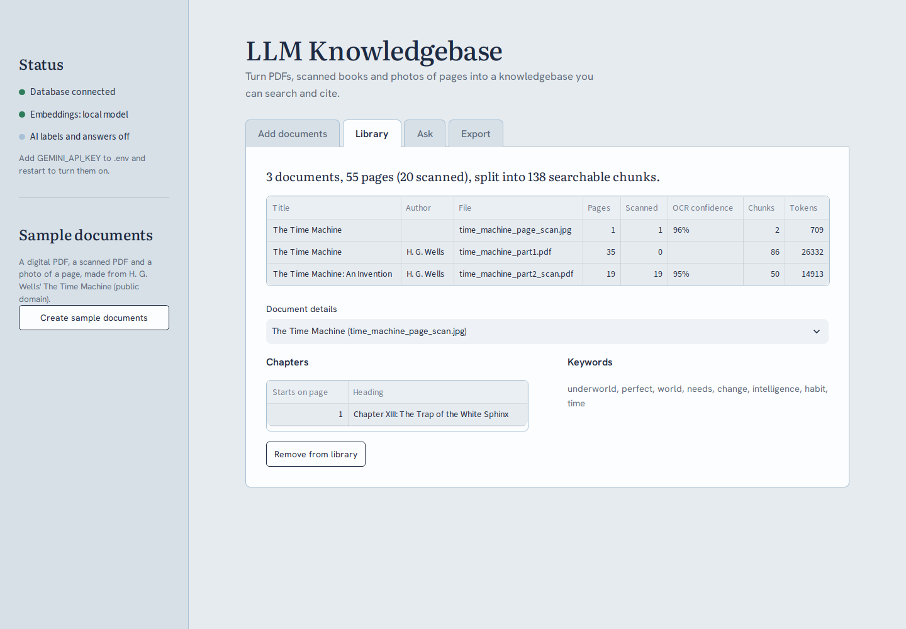
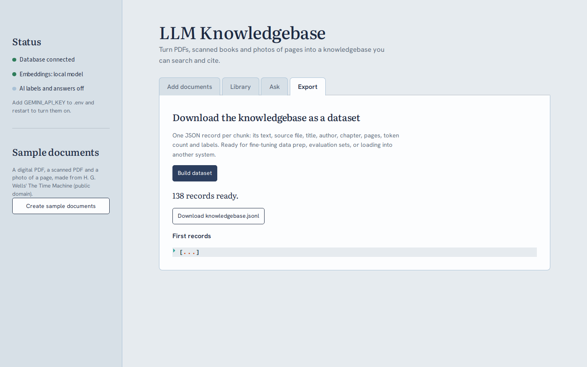
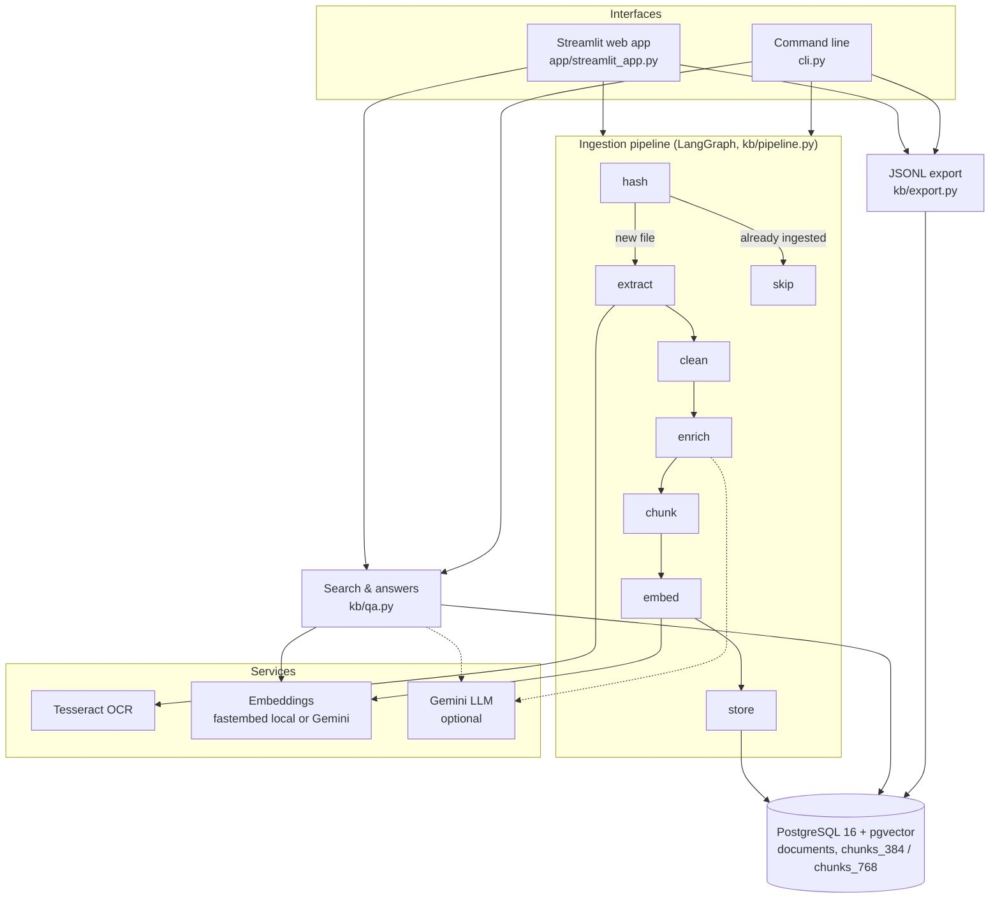

# LLM Knowledgebase Pipeline

Turn piles of documents (digital PDFs, scanned books, photographed pages) into a clean, searchable knowledgebase for LLMs.

The pipeline OCRs scanned pages, strips print artifacts, extracts metadata (title, author, chapters, topic labels), chunks the text along paragraph and chapter boundaries, embeds it, and stores everything in PostgreSQL with pgvector. You can then search it semantically, ask questions with cited answers, or export it as a JSONL dataset for training and evaluation.

It is orchestrated as a **LangGraph** state graph with per-stage timing and data-quality warnings. It is idempotent (unchanged files are skipped) and runs fully offline by default; a Gemini API key adds LLM labeling and generated answers. Use it from a **web interface** (Streamlit) or the **command line**.

> Adapted from the document-ingestion side of a production multi-source RAG system I built as an AI Engineer at US Farm Data, extended here with OCR, metadata extraction, dataset export and a web interface.



## Contents

- [Quick start (web interface)](#quick-start-web-interface)
- [Quick start (command line)](#quick-start-command-line)
- [Architecture](#architecture)
- [How each stage works](#how-each-stage-works)
- [How search and answers work](#how-search-and-answers-work)
- [Data model](#data-model)
- [Configuration](#configuration)
- [Example run](#example-run)
- [Design decisions](#design-decisions)
- [Limitations and next steps](#limitations-and-next-steps)
- [Project layout](#project-layout)

## Quick start (web interface)

Requires Docker.

```bash
git clone https://github.com/Akaashneedsaname/llm-knowledgebase-pipeline.git
cd llm-knowledgebase-pipeline
docker compose up -d --build ui
```

Open **http://localhost:8501**, then:

1. Click **Create sample documents** in the sidebar. It builds three test documents from a public-domain book (*The Time Machine*, H. G. Wells): a digital PDF, an image-only "scanned" PDF with skew and noise, and a scanned photo of a page.
2. **Add documents** tab: click **Add sample documents**, or upload your own PDFs and images. Each file shows its pipeline stages live, then a short report: pages, how many were scanned, OCR confidence, chunks, tokens, chapters, labels, where the time went, and any warnings.
3. **Library** tab: everything in the knowledgebase, with chapters and labels per document. Documents can be removed here.
4. **Ask** tab: type a question. **Ask** returns an answer with numbered sources (chapter and page). **Show matching passages** shows the passages in full.
5. **Export** tab: **Build dataset**, then download the whole knowledgebase as a JSONL file.

Stop it with `docker compose down`. Add `-v` to also delete the database. If ports 5433 or 8501 are taken, set `KB_DB_PORT` and `KB_UI_PORT` in `.env`.

The interface is styled as an archive reading room. Retrieved passages are drawn as library catalog cards: ruled card stock, a red header rule, a typewritten citation. The styling lives in `app/theme.py`.

| Add documents | Library | Export |
|---|---|---|
|  |  |  |

## Quick start (command line)

```bash
docker compose up -d db
docker compose build

docker compose run --rm app python scripts/make_samples.py          # sample documents
docker compose run --rm app python cli.py ingest samples/           # run the pipeline
docker compose run --rm app python cli.py stats                     # what's stored
docker compose run --rm app python cli.py search "What are the Morlocks?"
docker compose run --rm app python cli.py ask "What happened to Weena?"
docker compose run --rm app python cli.py export output/knowledgebase.jsonl

docker compose run --rm --no-deps app python -m pytest -q          # unit tests
```

To enable LLM labeling and generated answers, copy `.env.example` to `.env` and set `GEMINI_API_KEY`, then restart (`docker compose up -d ui` for the web interface).

## Architecture



Everything runs in Docker Compose as three services:

| Service | What it is |
|---|---|
| `db` | `pgvector/pgvector:pg16`, the database (host port 5433) |
| `ui` | The Streamlit web interface (host port 8501) |
| `app` | The same image, used to run CLI commands and tests |

`ui` and `app` share one image. The `samples/` and `output/` folders are mounted into the containers, so generated samples, uploads and exports appear on your machine. Downloaded models (the embedding model and the tokenizer) are cached in a Docker volume, so they download only once.

**How the pieces connect:** the interfaces never touch the database directly for ingestion. They call `ingest_file()` in `kb/pipeline.py`, which runs the LangGraph graph. Each node is a small function that reads the shared pipeline state and returns only the fields it adds. A decorator times every node, and the results are merged into a run report. The web interface subscribes to the graph's stream of node updates to show progress live.

## How each stage works

| # | Stage | Module | What happens |
|---|---|---|---|
| 1 | **hash** | `pipeline.py` | SHA-256 of the file's bytes. If the same file was already ingested with the same embedding model, the run stops here ("skipped"). With *re-process* / `--force`, the old copy is deleted and the file runs again. |
| 2 | **extract** | `extract.py` | **PDFs:** each page's text layer is read line by line. If a page has fewer than 40 characters of text, it's treated as a scan: rendered to a 300 DPI grayscale image and OCR'd with Tesseract. **Images:** OCR'd directly. **Text files:** read as-is. For both digital and scanned pages, paragraphs are rebuilt from line geometry: a gap clearly larger than the page's typical line gap (typical gap + half a line height) starts a new paragraph, which works for single, 1.5 and double spacing. Neither PDF "blocks" (often one per line in Word exports) nor Tesseract's paragraph guesses are reliable. Mean OCR word confidence is recorded per page, and pages under 60% raise a warning. |
| 3 | **clean** | `clean.py` | **Headers/footers:** short lines in the top or bottom two lines of a page that repeat on at least half the pages (digits ignored, so "Page 3" and "Page 4" match) are removed. Chapter headings are protected. Also: bare page numbers and soft hyphens removed, words hyphenated across lines rejoined, curly quotes normalized, hard-wrapped lines unwrapped into paragraphs. |
| 4 | **enrich** | `metadata.py` | **Title/author:** embedded PDF fields win; otherwise Project Gutenberg headers or the title page ("THE TIME MACHINE / An Invention / by H. G. Wells"). This uses the *raw* first page, because cleaning removes the running header that often holds the title. **Chapters:** headings like "Chapter IV: ...". **Labels:** with a Gemini key, the LLM returns a JSON summary, topics, genre and language; otherwise the top keywords by frequency (stopwords removed). |
| 5 | **chunk** | `chunk.py` | Builds chunks from whole paragraphs up to 400 tokens (tiktoken `cl100k_base`), with 60 tokens of overlap carried into the next chunk. A chapter heading always starts a new chunk (no overlap across chapters). Sentences broken across a page break are rejoined first. Paragraphs bigger than a chunk are split on token boundaries. Every chunk records its first and last page and its chapter. |
| 6 | **embed** | `embed.py` | **local:** `BAAI/bge-small-en-v1.5` via fastembed (ONNX on CPU, 384 dimensions, no key). **gemini:** `gemini-embedding-001` at 768 dimensions with retrieval task types, re-normalized. |
| 7 | **store** | `store.py` | The document row and all chunk rows are written in **one transaction**, so a failure never leaves a half-stored document. |

## How search and answers work

1. The question is embedded with the same model used for the documents (as a *query* embedding).
2. pgvector finds the closest chunks by cosine distance (`ORDER BY embedding <=> query`), using an HNSW index.
3. Each result is labeled with a citation built from its stored metadata: *title, chapter, page(s)*.
4. **With a Gemini key**, the top passages are numbered and sent to the LLM with instructions to answer only from them and cite like [1]. **Without a key**, the most relevant passage is returned (extractive mode). The sources list is shown either way.

## LLM cost controls

The LLM is optional, and when it's on, usage is small and bounded:

| Where | LLM calls | Approximate tokens |
|---|---|---|
| Ingest | 1 per document (labels) | about 1,200 in, under 400 out, no matter how long the document is |
| Ask | 1 per question | about 2,000-2,500 in (top 5 passages), under 600 out |
| Ask, same question again | 0 (answer cache) | 0 |
| Show matching passages, chunking, OCR, local embeddings | 0 | 0 |

- **Thinking disabled** on Flash models (`thinking_budget=0`). Labeling and cited answers don't need it, and thinking tokens are billed as output.
- **Bounded input:** labeling sends a fixed-size excerpt (start, middle and end), so a 1,000-page book costs the same as a 10-page report. Answers send only the top-k retrieved passages.
- **Capped output** on every call (`max_output_tokens`).
- **Answer cache:** the same question over the same passages reuses the earlier answer.
- **Hard limit:** `LLM_MAX_CALLS` (default 200 per running process). Beyond it, the app falls back to keyword labels and extractive answers instead of calling the API.
- **No automatic retries.** A failed call (invalid key, rate limit) falls back immediately and the reason is shown, so errors never loop.
- **Embeddings stay local** unless `EMBEDDING_PROVIDER=gemini` is set. Adding a key alone doesn't change embeddings.
- **Visible usage:** the web sidebar and the CLI show calls and tokens used since start.

## Data model

```sql
documents (
  id, file_hash, source_file, title, author, language,
  page_count, ocr_pages, ocr_mean_confidence,
  metadata JSONB,              -- chapters, labels, embedded PDF fields
  embedding_model,             -- e.g. local:BAAI/bge-small-en-v1.5
  created_at,
  UNIQUE (file_hash, embedding_model)
)

chunks_384 / chunks_768 (
  id, document_id -> documents(id) ON DELETE CASCADE,
  chunk_index, chunk_text, page_start, page_end, chapter, token_count,
  embedding vector(384 | 768),  -- HNSW index, cosine distance
  UNIQUE (document_id, chunk_index)
)
```

There is one chunk table per vector size, so documents embedded locally and with Gemini can coexist. Deleting a document deletes its chunks automatically.

## Configuration

All settings come from environment variables (or a `.env` file). See `.env.example`.

| Variable | Default | Meaning |
|---|---|---|
| `EMBEDDING_PROVIDER` | `local` | `local` (offline, 384-dim) or `gemini` (768-dim) |
| `GEMINI_API_KEY` | empty | Turns on LLM labeling and written answers |
| `GEMINI_LLM_MODEL` | `gemini-2.5-flash` | Model for labels and answers |
| `GEMINI_EMBEDDING_MODEL` | `gemini-embedding-001` | Model for Gemini embeddings |
| `LLM_MAX_CALLS` | `200` | Safety cap on LLM calls per running process; after it, features fall back to non-LLM mode |
| `LLM_LABEL_CHARS` | `4000` | Size of the excerpt sent to the LLM for labeling (start, middle and end of the document) |
| `LOCAL_EMBEDDING_MODEL` | `BAAI/bge-small-en-v1.5` | Model for local embeddings |
| `OCR_MIN_CHARS` | `40` | Below this many text-layer characters, a PDF page is OCR'd |
| `OCR_DPI` | `300` | Render resolution for OCR |
| `OCR_LANG` | `eng` | Tesseract language |
| `CHUNK_SIZE` / `CHUNK_OVERLAP` | `400` / `60` | Chunk size and overlap in tokens |
| `TOP_K` | `5` | Passages retrieved per question |
| `DATABASE_URL` | set by Compose | Postgres connection string |

## Example run

Three sample files: 55 pages, 20 of them scanned. Laptop CPU, local embeddings.

```
$ python cli.py stats
 id  file                             title                        pages  ocr  conf chunks  tokens
  1  time_machine_page_scan.jpg       The Time Machine                 1    1    96      2     709
  2  time_machine_part1.pdf           The Time Machine                35    0     -     86   26323
  3  time_machine_part2_scan.pdf      The Time Machine: An Inventi    19   19    95     50   14915
```

The scanned PDF has no text layer and no embedded metadata, yet title and author are still recovered from the OCR'd title page:

```json
{
  "file": "time_machine_part2_scan.pdf",
  "status": "ingested",
  "title": "The Time Machine: An Invention",
  "author": "H. G. Wells",
  "pages": 19,
  "ocr_pages": 19,
  "ocr_mean_confidence": 95.4,
  "chapters": 4,
  "chunks": 50,
  "seconds": {"hash": 0.12, "extract": 45.8, "clean": 0.01, "enrich": 0.0, "chunk": 0.02, "embed": 8.84, "store": 0.32},
  "warnings": []
}
```

OCR dominates the run time (about 2.4 s per page at 300 DPI). The per-stage timings show exactly where to optimize.

Retrieval works across digital and scanned sources, with citations down to the chapter and page:

```
$ python cli.py ask "What happened to Weena?"
Sources (extractive mode):
  [1] The Time Machine, Chapter VIII: Explanation, p. 35  (similarity 0.652)
  [2] The Time Machine: An Invention, Chapter XII: In the Darkness, pp. 15-16  (similarity 0.635)
  [3] The Time Machine, Chapter VIII: Explanation, pp. 30-31  (similarity 0.634)
```

Each line of the JSONL export is a self-contained record:

```json
{"id": "2-7", "text": "...", "source": "time_machine_part1.pdf", "title": "The Time Machine",
 "author": "H. G. Wells", "chapter": "Chapter II: The Machine", "pages": [7, 7], "tokens": 320,
 "labels": {"keywords": ["time", "little", "machine", "..."], "labeled_by": "keywords"}}
```

## Design decisions

- **OCR only where needed.** Each PDF page is checked individually, so a mostly digital document with a few scanned inserts is OCR'd only on those pages. That's faster and more accurate than OCR'ing everything.
- **Paragraphs from geometry.** On scans, Tesseract often starts "new paragraphs" mid-sentence, and many digital PDFs store every line as a separate block. Rebuilding paragraphs from line gaps, relative to each page's own typical spacing, fixed both. On a real double-spaced 23-page report, mid-sentence paragraph breaks went from 28 to 2 (the remaining two are list items).
- **Paragraph-aware chunks with citations.** Splitting on raw token windows cuts sentences and mixes chapters. Chunks built from whole paragraphs, starting at chapter headings, retrieve better and cite precisely.
- **Idempotent by content hash.** Re-running on a growing archive only processes new or changed files.
- **Offline first, cloud optional.** The full pipeline runs with no API key. An LLM adds richer labels and written answers when a key is set, and every LLM call falls back gracefully if it fails.
- **Observable.** Per-stage timings and quality warnings come back on every run, in the terminal and in the web interface.
- **One transaction per document.** A crash mid-ingest never leaves partial data.
- **HNSW over IVFFlat.** HNSW needs no training step, so search quality is good from the first document. It suits a knowledgebase that grows incrementally.

## Limitations and next steps

- OCR runs page by page on one CPU core; parallelizing pages across processes would cut ingest time roughly by the number of cores.
- Layout is treated as single-column reading order. Multi-column pages and tables would need layout analysis (for example, Tesseract page-segmentation modes or a layout model).
- Chapter detection covers "Chapter / Part / Book / Section + number" headings. Other heading styles would need extra patterns or LLM-based structure detection.
- Search is pure vector similarity. Adding keyword (BM25) search and re-ranking would improve exact-name and rare-term queries.

## Project layout

```
app/
  streamlit_app.py  web interface (Add documents, Library, Ask, Export)
  theme.py          reading-room styling: palette, fonts, catalog cards
kb/
  config.py         settings from environment variables
  extract.py        text layer + Tesseract OCR, paragraph rebuilding
  clean.py          header/footer removal, de-hyphenation, unwrapping
  metadata.py       title/author/chapters, LLM or keyword labels
  chunk.py          paragraph- and chapter-aware token chunking
  embed.py          local (fastembed) and Gemini embedders
  llm.py            optional Gemini wrapper
  store.py          Postgres + pgvector schema, writes, similarity search
  pipeline.py       LangGraph orchestration, timing, run reports
  qa.py             retrieval and cited answers
  export.py         JSONL dataset export
cli.py              ingest / search / ask / export / stats
scripts/make_samples.py   builds the sample corpus
tests/              unit tests for cleaning, chunking and metadata
docs/screenshots/   interface screenshots
```

## Tech stack

Python 3.12 · LangGraph · Streamlit · PyMuPDF · Tesseract (pytesseract) · tiktoken · fastembed · Google Gemini API · PostgreSQL 16 + pgvector · Docker Compose · pytest · GitHub Actions
